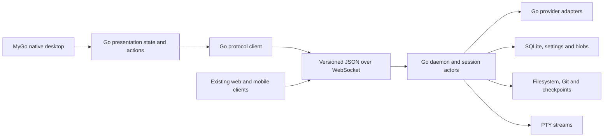

# Waku in Go with MyGo

## Outcome

Build Waku's native desktop and daemon in Go using MyGo, with the existing product's capabilities and a clearer, equally polished interface. Improve performance through measured changes, not assumptions about the language or framework.

The implementation stays in **`roshankarande/waku`, branch `waku-go`**. There is no new application repository. Reusable MyGo improvements may be developed in the existing `roshankarande/mygo` fork and pinned from Waku. This document is an execution plan; no migration implementation has started.

Use MyGo's **native `ui` package**, through `WindowOptions.Content: ui.View(...)`, for the desktop. Compose existing widgets, build Waku-specific components in Waku, and extend MyGo where an early prototype demonstrates a reusable framework gap.

The final application-owned desktop, daemon, providers, persistence, and supervision logic must be Go. A Go desktop talking to the Rust daemon is a temporary migration milestone, not completion. Existing web/mobile clients remain protocol clients. Third-party native libraries and necessary provider/SDK JavaScript assets are permitted; identify their purpose and packaging explicitly rather than claiming every dependency is Go.

## Research and source baseline

Planning baseline, 2026-10-04:

| Reference | Revision or evidence | Use |
| --- | --- | --- |
| Waku | `10bcd728c9b2f07d664cfece3c8c870d3418ddd2` | Current behavior, UI, wire contract, storage, performance |
| [MyGo upstream](https://github.com/egoist/mygo/tree/main) | `e112810768ddbc19f8613c99d875a1967ca31af5` | Current native toolkit and upstream APIs |
| MyGo local fork | `50be73e3d1ba69b8e46641cefd45460e14932ea2`, release 0.2.7 | Tested development dependency and possible extension base |
| [MyGo documentation](https://mygo.egoist.dev/) | `docs/`, `docs/ui/`, and `website/src/lib/docs.server.ts` in MyGo | Documentation source used by the site |
| [T3 Code](https://github.com/pingdotgg/t3code) | `4ee6bfd50ef4a089440d5c3662db2298da9cc50e` | Targeted current workflow/hierarchy reference required by Waku guidance |

The live documentation domain returned HTTP 403 in this environment. The website source confirms that it renders the repository's `docs/` files. Native UI documentation was read locally and checked against upstream raw source; live-site access is not claimed. Recheck upstream changes before pinning the implementation dependency.

Read these before implementation:

- Waku: `AGENTS.md`, `CONTRIBUTING.md`, `docs/performance.md`, `docs/providers.md`, `docs/computer-use.md`, `RELEASING.md`.
- MyGo: `AGENTS.md`, `docs/architecture.md`, `docs/ui/README.md`, `views.md`, `list.md`, `custom-widgets.md`, `accessibility.md`, `rendering.md`, `testing.md`, and `docs/plugins/terminal.md`.
- Waku contracts: `crates/waku-protocol/src/`, `crates/waku-client/src/`, `crates/waku-core/src/server.rs`, `daemon.rs`, `persistence.rs`, and `db/migrations/`.

## Architecture



During the first usable milestone, the Rust daemon occupies the daemon box. Replace it behind the same wire contract after compatibility tests pass. Only one daemon implementation may own a writable data directory at a time.

Suggested layout, to confirm against repository conventions in phase 0:

```text
apps/desktop-go/              Go module and native desktop entry point
  cmd/waku-go/                Desktop executable
  cmd/waku-go-daemon/         Daemon executable
  internal/protocol/          Wire types, codecs and compatibility fixtures
  internal/client/            RPC, reconnect, replay and daemon supervision
  internal/presentation/      UI state, reducers, actions and navigation
  internal/views/             Shell, transcript, composer, panels and settings
  internal/components/        Waku-specific native components
  internal/daemon/            Session ownership and command routing
  internal/providers/         Provider transports and session readers
  internal/storage/           SQLite, migrations, drafts and blob lifecycle
  internal/workspace/         Files, Git, checkpoints and projectless tasks
  internal/terminal/          Local/daemon terminal transport adapters
  internal/platform/          Application-specific platform integrations
  testdata/                   Sanitized streams, JSON and document fixtures
```

Keep persistent domain state separate from transient focus, list, selection, and layout state. Workers perform parsing, highlighting, math rendering, filesystem, Git, networking, and provider work. Apply small, generation-checked results using MyGo's `Window.Update`. A view only reads prepared state and constructs visible elements.

Pin MyGo to an exact tested version/revision. Use a local workspace or module replacement for fork development; published builds must resolve a reproducible version rather than an absolute local path. Keep `CGO_ENABLED=0`; Bun remains development/build tooling and is not a runtime prerequisite.

## Component strategy

| Surface | Reuse from MyGo | Waku component or proof needed |
| --- | --- | --- |
| Shell and navigation | Sidebar, split, tabs, menus, router, search, dialogs | Project/session hierarchy, pane state, command palette |
| Transcript | Variable-height `List`, stable keys, `FollowEnd`, rich text, images, links | Ordered streaming blocks, virtualized document layout, selection and search |
| Markdown and math | Rich text, drawing, tables, selectable text | Markdown parser/render model, fenced code, citations, inline/display math, copy actions |
| Composer | `TextAreaBase`, IME, autocomplete, combobox, token field, file drops | Provider-aware options, attachment staging, slash commands, drafts and goal controls |
| Tools and approvals | Collapsible, badges, forms, popovers, alert dialogs | Tool summaries/details, approval and question state machines |
| Files and review | Outline, virtualized lists/tables, split, find bar | Code editor, diff hunks, context expansion, line navigation and save conflicts |
| Terminal | `plugins/terminal`, Ghostty VT, transport interfaces | Daemon-backed stream adapter, lifecycle, find/navigation and accessible text |
| Browser | MyGo's system webview window | Prove inline embedding, focus, clipping and layering in a native pane; a separate window does not establish existing-pane parity |
| Settings, skills and usage | Forms, controls, tables, grids, native dialogs | Provider readiness, capability explanations, skill details and usage charts |

Build domain components in Waku first. Consider a framework extension only when composition cannot preserve the required behavior:

1. **Document-wide selection:** selection/copy across Markdown blocks, code, tables and virtualized rows; stable source offsets while streaming.
2. **Editor and IME APIs:** MyGo's built-in editing is the starting point. Custom `HandleInput`/`TextCaret` currently lacks surrounding text for IME; expose editing context only if the composer or code editor needs it.
3. **Pane invalidation/caching:** measure CPU view-building and layout. GPU damage tracking alone does not demonstrate that unchanged panes avoid CPU work.
4. **Embedded browser surfaces:** reusable native child-view integration only after confirming current platform APIs cannot support the Waku pane.
5. **Terminal accessibility and search:** expose content, selection, match navigation, and scroll-to-match where the plugin's current APIs cannot provide them.

Each framework change needs a minimal reproducible example, public API proposal, platform/fake/unsupported implementations where applicable, tests, docs, and a Waku integration test. Keep framework primitives independent of providers and transcript semantics. Preserve Waku's GPL license and notices; independently developed framework additions follow MyGo's licensing and contribution rules.

## Interface quality and clarity

Preserve Waku's useful visual character before changing structure: typography, spacing, colors, density, window chrome, selection, focus, transitions, and light/dark themes. Extract shared design tokens; do not replace the app with a generic chat demo.

- Make the hierarchy readable: **project/workspace → session → current activity**. Give navigation, metadata, and running status distinct prominence.
- Keep the answer dominant. Show reasoning and tools as ordered, keyboard-operable summaries with details available; preserve citations and provider ordering.
- Give the composer a consistent primary action with explicit preparing, running, waiting-for-approval, paused, and failed states. Keep stop, retry, queued messages, and `/goal` behavior understandable.
- Use consistent panel titles and reopen behavior for files, review, terminal, browser, and background work. Retain per-session scroll, tab, selection, and draft state.
- Explain provider capabilities and access modes at the point of use. Show unavailable actions with a reason and recovery path.
- Preserve native shortcuts, focus restoration, clipboard, input methods, and drag/drop. Cover keyboard-only use, VoiceOver/NVDA/Orca, high contrast, scale factors, and reduced motion.

Before changing an ambiguous coding-agent interaction, consult targeted current T3 Code source as required by Waku's `AGENTS.md`. Use it as behavioral evidence, not a replacement for Waku's identity or native conventions.

The planning pass inspected three useful behaviors at the recorded T3 revision:

- [Sidebar status resolution](https://github.com/pingdotgg/t3code/blob/4ee6bfd50ef4a089440d5c3662db2298da9cc50e/apps/web/src/components/Sidebar.logic.ts#L937): execution state and unread attention are separate; a background wait is not completion.
- [Composer activity/notices](https://github.com/pingdotgg/t3code/blob/4ee6bfd50ef4a089440d5c3662db2298da9cc50e/apps/web/src/components/chat/ComposerBannerStack.tsx#L30): one attached activity surface, discoverable notices, Escape and focus restoration. Urgent approvals must remain apparent.
- [Virtualized work log](https://github.com/pingdotgg/t3code/blob/4ee6bfd50ef4a089440d5c3662db2298da9cc50e/apps/web/src/components/chat/WorkLog.tsx#L4): consistent compact group geometry with separate selectable detail. Keep expanded groups virtualized.

## Phases and acceptance gates

| Phase | Deliverable | Required gate |
| --- | --- | --- |
| 0 — Inventory and baseline | Feature/platform/provider matrix, design tokens, sanitized fixtures, benchmark harness and dependency decisions | Every current flow has a destination, test, and owner; record baseline measurements and lock release comparison budgets |
| 1 — Prove difficult native surfaces | Streaming transcript, document selection/search/math, diff/editor, terminal transport, browser and pane invalidation probes | Demonstrate correctness and cost in runnable native prototypes; document actual MyGo gaps before extending it |
| 2 — Protocol and desktop slice | Typed Go client, temporary Rust daemon bridge, shell, composer and one end-to-end session | Create project/session → send → stream → approval → stop/reconnect → persisted resume; no placeholder-only success |
| 3 — Go daemon and storage | Authenticated transport, session actors, SQLite/settings/blobs, filesystem/Git/checkpoints, PTY | Existing Rust, Go, web and mobile clients interoperate; migration/recovery and concurrency fixtures pass |
| 4 — Provider transports | Complete Go provider adapters, discovery, models, options, history and capability handling | Recorded fixtures pass per adapter; authenticated live checks run where credentials exist; missing live checks remain explicit blockers to parity claims |
| 5 — Full UI and platform parity | Remaining panels/settings/skills/usage, native integrations, updater and packaging | Feature matrix is complete on each platform; experimental/unsupported features retain honest capability gates |
| 6 — Polish and cutover | Release benchmarks, interaction review, installers, upgrade/rollback and Go-default launch | No application-owned Rust desktop/core/client/daemon runtime in the Go distribution; UI, behavior, data and performance gates pass |

Framework work can proceed alongside phases 1–5 after its concrete gap is proven. Proceed through passed gates without asking for routine confirmations; investigate failed gates and report precise external blockers rather than lowering the requirements.

### Phase 0: freeze behavior, not code structure

Inventory the visible workflows in `src/app/`, rich document behavior in `src/md/`, terminal/browser behavior, platform differences, and release paths. Classify each as required parity, current experimental behavior, or a proposed improvement. Improvements must not conceal lost existing behavior.

Capture sanitized representative provider streams and JSON golden fixtures. Preserve protocol v7 tags, camelCase fields, optional-versus-null distinctions, UUID IDs, base64 bytes, errors, generations, daemon epochs, replay cursors, and event ordering. Use synthetic workspaces and copies of databases for migration tests.

Preserve integer precision with typed `uint64`/`int64` fields or `json.Decoder.UseNumber` for opaque payloads. Add Rust/Go fixtures above `2^53` and at integer boundaries, including 64-bit computer-use window IDs. Document existing TypeScript number limitations separately; do not silently change the wire representation to compensate.

Compare upstream MyGo with the local fork and select a reproducible base. Prove a `CGO_ENABLED=0` SQLite strategy that can read existing databases without changing schema semantics. Identify math rendering and JavaScript SDK host options early; do not defer those feasibility questions until cutover.

Record versions, licenses/notices, checksums and reproducible sources for MyGo, Ghostty VT/themes, fonts/icons, SQLite, math rendering, and JavaScript SDK/runtime assets. Ship MyGo's MIT notice; keep translated GPL Waku logic out of MIT framework files. Check the terminal plugin's platform floors against Waku's support matrix: macOS 13+, Linux glibc 2.28+ on x64/arm64, and Windows 10 1809+.

### Phase 1: retire the highest risks first

Create small native fixtures for a 10,000-row transcript, an expanding streamed row, a long reasoning block, mixed Markdown/code/tables/math, a large diff, and multiple independent panes. Verify scroll anchoring, FollowEnd behavior, selection/search offsets, copying and IME composition.

Prototype math off the UI thread with bounded queues/caches and selectable source fallback for invalid or pending formulas. Evaluate a Go implementation or an explicitly packaged third-party renderer; keep Waku-owned orchestration in Go. Prove the inline browser path on platforms where Waku currently supports it. Record platform exclusions that already exist separately from new regressions.

Use measured results to decide whether document selection, editor hooks, pane caching, browser embedding, or terminal accessibility need MyGo changes. Produce a small API and test plan for each confirmed extension.

### Phase 2: a usable vertical slice

Implement the Go protocol client and owned-daemon supervisor, then a native shell and one complete Codex workflow against the current Rust daemon. Support local and remote daemon connections, exact origin/token behavior, request cancellation, reconnect/replay, event deduplication and epoch resets.

Do not terminate an externally managed daemon. Preserve prompts, drafts and pending approvals across UI navigation. Load session summaries first and hydrate transcripts on demand. Use this milestone to verify UI quality while daemon work proceeds independently.

### Phase 3: backend replacement

Port session ownership, ordered per-session commands, bounded replay and response caches, slow-subscriber handling, background tasks and lifecycle. Slow filesystem/Git work must not prevent another session from hydrating or streaming.

Keep SQLite migration tags/schema, atomic drafts, incremental changed-row persistence, lazy transcript loading, and blob retention semantics. Prove migration idempotence and failure recovery on copies. Never run Rust and Go writers against the same data directory.

Enforce process-lifetime data-directory ownership and test that a second daemon is rejected. A Go-only lock cannot stop an unmodified legacy Rust daemon: use separate development directories by default and a shared supervisor/launch guard or compatible shared-lock support during transition and rollback. Prove the guard before testing shared production-data cutover.

Port attachments, projectless paths, filesystem browsing/editing, branches, checkpoints and Git operations. Fork/rewind must coordinate provider history, Git refs and database state with equivalent cleanup/recovery behavior. Preserve path ownership on the daemon host when connected remotely.

Adapt MyGo's terminal renderer to daemon-owned PTY streams rather than accidentally starting a local shell for a remote workspace. PTY output is ephemeral, not transcript replay content. Windows ConPTY is an improvement where the current daemon lacks Windows PTY support; validate it independently.

### Phase 4: provider migration groups

| Group | Providers | Specific behavior to preserve |
| --- | --- | --- |
| Codex | Codex CLI | Long-lived RPC, approval/questions, options, resume, goals, steering, background work and rewind capabilities |
| ACP | Cursor, Fx, Grok Build, Kimi Code | ACP lifecycle and each provider's capability restrictions |
| RPC | Pi, Oh My Pi | Streaming/event normalization, session history, continuation and runtime options |
| Streaming JSON | Claude Code, Amp | Process framing, permissions, continuity, ordered tool activity and citations |
| HTTP/SSE | OpenCode | Connection/session lifecycle, streamed events, permissions and cancellation |
| HTTP/downlink | DeepSeek Harness | Harness-specific streaming, history, controls and capability handling |

For each adapter cover discovery/auth status, model catalog, access/reasoning options, attachments, prompts, streaming text/reasoning/tools, usage, cancellation, questions/approvals, imported history, resume, background work, goals, and fork/rewind where supported. Keep unsupported actions explicit. Share transport infrastructure without pretending provider capabilities are interchangeable.

### Phase 5: parity and releases

Complete files/code editing/Markdown preview, diff/review, commit flow, terminal/browser, command palette, navigation/search, settings, skills, usage, images, and all less common session states. Follow platform feature availability in the existing product.

Port computer-use host orchestration and the JavaScript REPL/controller contract; package and verify pinned SDK artifacts. Keep current experimental and host-permission gates. MyGo's generic updater is not automatically compatible with Waku's feeds: test signing, keys, app identity, feeds, staged replacement and rollback before choosing the integration.

Ship macOS, Linux and Windows builds with their native libraries/assets and no first-run Ghostty download. Test macOS signing/notarization and updater behavior, Windows installation identity and signed updates, and Linux install-prefix layout and staged update recovery. Provide an upgrade/rollback path that preserves existing data.

## Performance and verification

Create a release-build comparison report on the same machine, display, dataset and workload. Record startup/time-to-interactive, first-session hydration, input-to-paint latency, p50/p95/p99 frame time, streaming CPU, idle wakeups, RSS/heap, allocations, reconnect and shutdown. Debug CPU numbers in `docs/performance.md` are historical evidence, not portable release thresholds.

Record the renderer, device, display refresh and scale. Compare native GPU rendering with `MYGO_GPU=0` fallback, HiDPI, simultaneous terminal/streaming activity, and unchanged-pane allocation/layout costs. CPU frame work and input-to-present latency are separate measurements; satisfying a CPU budget alone does not establish smooth presentation.

At phase 0, set numeric limits from the baseline and target hardware. A proposed responsiveness target is p95 frame work within the display budget: 16.7 ms at 60 Hz or 8.3 ms at 120 Hz. Validate feasibility before treating that as a promise. Cutover must not regress baseline startup, interaction, CPU or memory without a measured, documented decision.

Hard architectural gates:

- No filesystem/network/subprocess work, synchronous IPC, expensive parsing, or blocking locks in views and row builders.
- Work scales with visible rows, with stable identities and bounded parse/highlight/math caches. Very large reasoning blocks use a bounded live window.
- Stream updates are coalesced at the existing approximately 120 ms cadence, including reasoning-only streams. Cancellation and approvals bypass batching when responsiveness requires it.
- No perpetual idle animation. Clocks park without active clients; decorative updates respect reduced motion and do not invalidate unrelated panes.
- Async results use generation checks; obsolete search, hydration and rendering jobs cannot overwrite newer state.
- Queues, replay and caches have byte limits as well as counts. Measure behavior under slow clients and rapid switching.

| Layer | Verification |
| --- | --- |
| Protocol | Rust/Go/TypeScript golden fixtures and cross-client interoperability |
| Daemon | Auth/origin, sequencing/replay, stale epochs, response cache limits, slow subscribers, multisession ordering and shutdown |
| Storage | Existing DB compatibility, migration/recovery, lazy hydration, changed-row writes, concurrent drafts and blob retention |
| Providers | Sanitized transport replay fixtures plus credentialed live smoke checks |
| Components | MyGo headless interaction tests for navigation, disclosures, approvals, selection/search, drafts, list anchoring and IME-related behavior |
| Native UI | Running-app keyboard/clipboard/drop/IME/screen-reader checks, theme/scale/motion checks; appearance review on runnable native platforms |
| Performance | Reproducible release workloads: long transcript, fast reasoning, large diff, resize/theme change, terminal plus streaming |
| Packaging | Signed/verified assets, clean-machine startup, upgrade/rollback, data preservation and no development-runtime dependency |

Use the existing source tests as specifications; translate behavior rather than copying implementation structure. Current verified environment baseline: 557 headless Waku Rust tests passed (29 ignored), 160 client/web JavaScript tests passed, protocol check and Linux desktop compile passed; MyGo had 520 Go tests pass (11 skipped), 35 JavaScript tests pass, typechecks and platform builds pass.

Linux MyGo webview GUI E2E is currently blocked: the container cannot install WebKitGTK helper executables at required system paths, and local namespace setup also fails. Headless/native tests are useful but do not replace real GUI validation. Arrange a suitable Linux image and macOS/Windows runners before claiming full platform parity.

## Parallel work and integration

Use sub-agents where contracts allow independent work. The primary agent owns architecture, shared contracts, dependency pins, reviews and integration. Do not assign simultaneous edits to the same files.

| Agent track | Initial ownership | Dependencies |
| --- | --- | --- |
| Protocol and client | Wire codecs, golden fixtures, reconnect and supervision | Phase 0 contracts |
| Native UI | Shell, presentation state, composer, transcript | Client interface; rich-document proof |
| Document components | Markdown/math, selection/search, code/diff | Design tokens; reusable MyGo primitives |
| Daemon and storage | Session actors, persistence, workspaces/Git | Wire/storage fixtures |
| Provider adapters | One transport group per agent | Session and event contracts |
| Framework | Confirmed MyGo extension per agent | Minimal proof and agreed public API |
| Validation and release | Replay/benchmark harness, native matrix, packaging | Stable interfaces and build artifacts |

Start with protocol/client, difficult-component proofs, and baseline fixtures in parallel. Integrate small vertical slices before expanding provider groups. Run a review agent against each substantial integrated slice for behavior loss, UI-thread work, protocol drift, and missing tests. Compilation alone is not a phase gate.

## Completion and handoff

Keep `docs/waku-go-progress.md` during execution with phase status, feature matrix, decisions, changed areas, actual checks/results, measurements, and unresolved blockers. Distinguish passed, failed, skipped, ignored, and unrun checks.

The `/goal` handoff is in [waku-go-goal.md](waku-go-goal.md). Completion means a usable native Go application, Go daemon/provider/storage logic, verified data and release compatibility, a clear polished UI, and measured performance. An attractive shell, untested backend, temporary Rust bridge, or reduced feature list does not satisfy that goal.
